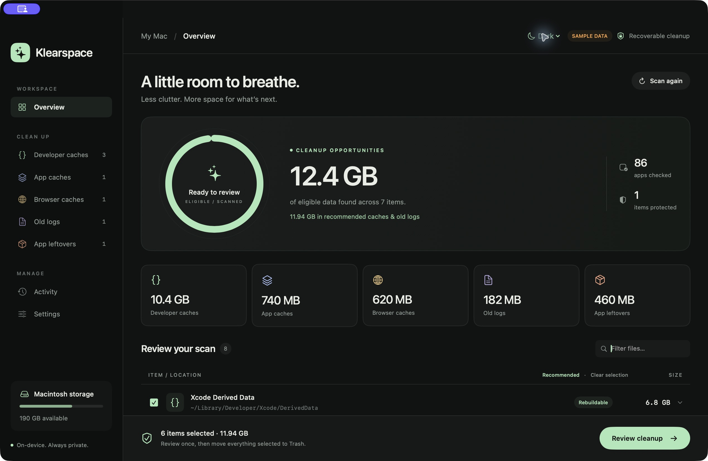
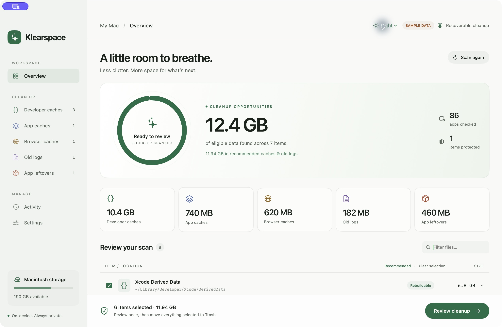

# Klearspace

**See the clutter. Review the files. Make room.**

A native, open-source Mac app for visual cache cleanup and reviewing data left by removed applications. Built with SwiftUI and AppKit, with no third-party runtime dependencies.

[](https://github.com/kunal-shekte/klearspace/actions/workflows/ci.yml)
[](LICENSE)
[](docs/INSTALLATION.md)

**[Download Klearspace 1.1.0 — Apple silicon DMG](https://github.com/kunal-shekte/klearspace/releases/download/v1.1.0/Klearspace-1.1.0-arm64.dmg)** · [All releases](https://github.com/kunal-shekte/klearspace/releases) · [Installation](docs/INSTALLATION.md) · [Usage](docs/USAGE.md)

> The published v1.1.0 app is ad-hoc signed and **not Apple-notarized**. Review the [first-launch instructions](docs/INSTALLATION.md#first-launch-and-signing) before installing a downloaded copy. The DMG requires an Apple silicon Mac and macOS 14 or later.

| Dark | Light |
| --- | --- |
|  |  |

Screenshots show sample data. Normal launches wait for an explicit scan.

## What it does

- **Visual scans:** sizes, category totals, locations, explanations, filters, and Finder reveal actions.
- **Developer caches:** Xcode, Gradle, npm, Yarn, pnpm cache, Homebrew, CocoaPods, pip, SwiftPM, Cargo, Flutter/Dart downloads, JetBrains, Android Studio, and VS Code.
- **Everyday cleanup:** user app caches, recognized browser caches, and user logs older than 30 days.
- **App leftovers:** candidates in Containers, Preferences, Application Support, Application Scripts, Saved Application State, HTTPStorages, and WebKit. A local app-name history improves recognition after future uninstalls.
- **Reviewed batch cleanup:** select eligible leftovers together, review once, then move the selected items to Trash in one batch.
- **Recovery:** cleanup history with Restore and Reveal in Trash controls.
- **Appearance:** **System / Light / Dark**, with **System as the initial default**. Switch using the top-bar menu or Settings; the choice is saved.
- **Local operation:** no account, telemetry, automatic uploads, administrator password, privileged helper, or background service.

## Install

1. [Download the DMG](https://github.com/kunal-shekte/klearspace/releases/download/v1.1.0/Klearspace-1.1.0-arm64.dmg).
2. Open it and drag **Klearspace.app** to **Applications**.
3. Eject the disk image and open Klearspace from Applications.
4. Follow the [first-launch and optional permissions guide](docs/INSTALLATION.md) if macOS blocks launch or access to protected folders.

Release assets include `SHA256SUMS.txt`. See the guide for checksum verification, upgrades, uninstallation, and building on Intel Macs.

## Use

1. Quit apps whose caches you plan to clean, then click **Scan my Mac** or press **⌘R**.
2. Review category totals, file paths, and result explanations. Rebuildable results can be recommended; app leftovers are never selected automatically.
3. In **App leftovers**, select items individually or click **Select candidates** for eligible visible results.
4. Click **Review cleanup**, inspect the final paths, acknowledge reviewed app data if applicable, then click **Move selected to Trash**.
5. Use **Activity → Restore** if needed. Empty Trash in Finder yourself when you are ready to reclaim space.

**Moving files to Trash generally does not free their disk space until Trash is emptied.** Recovery is available only while the files remain there. Full instructions and troubleshooting are in the [usage guide](docs/USAGE.md).

## Safety and limits

Klearspace uses approved user-folder locations, excludes symbolic-link targets and incomplete scans, checks file identity and modification time before moving an item, and avoids overlapping targets. Running apps/tools, Apple data, and shared group containers are protected. Restore refuses to overwrite a recreated destination.

A missing application makes its data a **candidate**, not proven abandoned data. Containers may hold documents or databases. Shared ownership, disconnected volumes, custom installation paths, and helper services prevent a reliable “erase every trace” guarantee. Shared containers stay protected; use a vendor's official uninstaller for services and system extensions.

Browser passwords, cookies, history, and bookmarks; simulator devices; editor workspaces; system folders; cloud data; Keychain entries; and automatic Trash emptying are outside the cleanup scope. Read [safety, coverage, and privacy](docs/SAFETY.md) before selecting unfamiliar data.

## Build from source

Requires a Mac with **Swift 6 or newer** and the Xcode developer tools. The package targets macOS 14 or later and builds for the host architecture by default.

```sh
git clone https://github.com/kunal-shekte/klearspace.git
cd klearspace
swift test
./build.sh
open dist/Klearspace.app
```

Create an architecture-labelled DMG and its checksum:

```sh
./scripts/package-dmg.sh
```

Build outputs live in `dist/`. Set `KLEARSPACE_BUILD_DIR` for another scratch directory or `KLEARSPACE_OUTPUT_DIR` for another app/DMG destination. The default build uses ad-hoc signing. Developer ID signing and notarization require your own Apple distribution credentials; see the [signing and notarization guide](docs/NOTARIZATION.md). The scripts do not change the existing public release's signing status.

Preview the UI without enabling cleanup:

```sh
open dist/Klearspace.app --args --demo
```

The automated suite covers cleanup boundaries, symlinks, stale targets, browser profile protection, old-log rules, installed/running apps, protected containers, cancellation, overlap handling, named support-folder recognition, history, restore protection, and a generated fixture's round trip through macOS Trash. Existing user data is not removed by the tests. CI runs tests, builds the app, and verifies DMG packaging on macOS.

## Project

- [Installation](docs/INSTALLATION.md) · [Usage](docs/USAGE.md) · [Safety and privacy](docs/SAFETY.md)
- [Changelog](CHANGELOG.md) · [Contributing](CONTRIBUTING.md) · [Security reports](SECURITY.md)
- [Issues](https://github.com/kunal-shekte/klearspace/issues) — redact private paths and scan reports.

Klearspace is licensed under the [MIT License](LICENSE), copyright © 2026 Kunal Shekte. Cleanup categories were inspired by the `dev-cleaner` shell utility; Klearspace is an independent Swift implementation and does not include or execute the original script. See [NOTICE](NOTICE) for attribution and platform-asset information.
